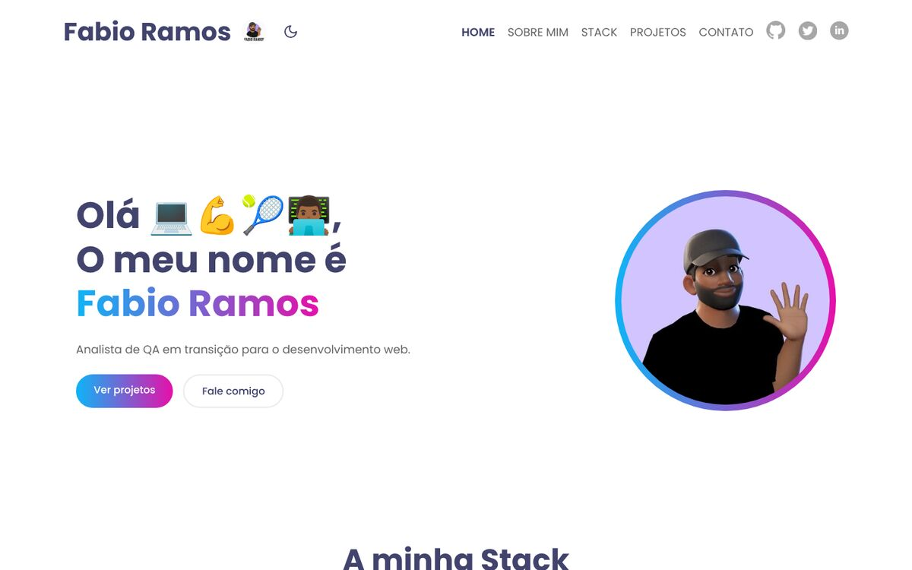
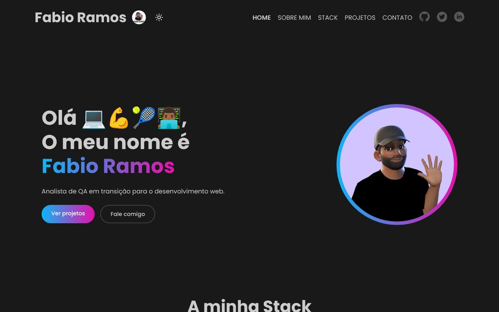
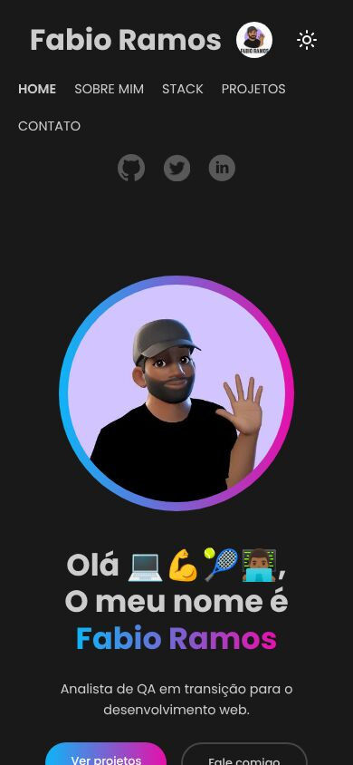
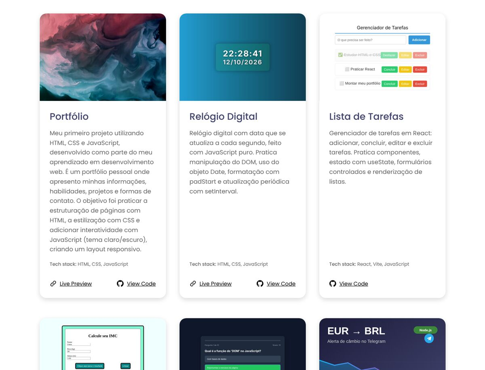

# 🌟 Portfólio — Fabio Ramos

Portfólio pessoal feito com **HTML**, **CSS** e **JavaScript**, começado com a ajuda do curso **Viver de Código**.
Apresenta meu perfil, minha stack, meus projetos, certificados e formas de contato.

🔗 **Acesse:** https://fpramos1976.github.io/Projeto-Profile/



## 🚀 Tecnologias usadas
- HTML5 (semântico e acessível)
- CSS3 (variáveis CSS, Flexbox, Grid e media queries)
- JavaScript (tema claro/escuro salvo no navegador)

## ✨ Funcionalidades
- Layout responsivo (desktop, tablet e celular)
- Tema claro/escuro, que segue o tema do sistema e lembra a escolha do visitante
- Destaque da página atual no menu e foco visível para navegação pelo teclado
- Links externos abrindo em nova aba com segurança (`rel="noopener noreferrer"`)
- Imagens otimizadas e carregamento preguiçoso (`loading="lazy"`)

## 📄 Páginas
| Página | Conteúdo |
| --- | --- |
| **Home** | Apresentação, stack e projetos |
| **Sobre mim** | Resumo, experiência, certificados e formação |
| **Stack** | Tecnologias com que trabalho |
| **Projetos** | Projetos desenvolvidos, com links para código e demonstração |
| **Contato** | E-mail e redes sociais |

## 💼 Projetos em destaque
| Projeto | Tecnologias | Código |
| --- | --- | --- |
| Portfólio | HTML, CSS, JavaScript | [Projeto-Profile](https://github.com/fpramos1976/Projeto-Profile) |
| Relógio Digital | HTML, CSS, JavaScript | [RELOGIO](https://github.com/fpramos1976/RELOGIO) |
| Lista de Tarefas | React, Vite | [LISTA_DE_TAREFAS](https://github.com/fpramos1976/LISTA_DE_TAREFAS) |
| Calculadora de IMC | HTML, CSS, JavaScript | Privado |
| Quiz de Desenvolvimento Web | HTML, CSS, JavaScript | Privado |
| Monitor de Câmbio EUR-BRL | Node.js, Express, API do Telegram | [monitor-moeda](https://github.com/fpramos1976/monitor-moeda) |
| Monitor de Cotação de Moedas | Python, AwesomeAPI, API do Telegram | Privado |

## 🎓 Certificados
- **Udemy** — Formação Front-end: HTML, CSS, JavaScript, React e + (51,5 horas) · [verificar](https://ude.my/UC-4c15fee2-aa6c-43c3-b62e-3e7e22669688)
- **Anthropic Academy** — Building with the Claude API · AI capabilities and limitations · Claude Platform 101 · Introduction to Claude Cowork · Claude Code 101 · Claude 101 · Claude Code in action

## 🖼️ Demonstração
| Tema escuro | Celular |
| --- | --- |
|  |  |



## 📁 Estrutura
```
├── index.html      # Página inicial (banner, stack e projetos)
├── about.html      # Sobre mim, experiência, certificados e formação
├── stack.html      # Tecnologias
├── project.html    # Projetos
├── contact.html    # Contato
├── css/
│   ├── _variables.css  # Cores, pesos de fonte e temas claro/escuro
│   └── main.css        # Estilos principais e responsividade
├── assets/
│   ├── main.js     # Tema claro/escuro e ano do rodapé
│   └── images/     # Fotos, ícones e capas dos projetos
└── docs/           # Prints usados neste README
```

## ▶️ Como rodar
1. Clone o repositório:
   ```bash
   git clone https://github.com/fpramos1976/Projeto-Profile.git
   ```
2. Abra a pasta no VS Code.
3. Clique com o botão direito no `index.html` → **Open with Live Server** (extensão Live Server), ou simplesmente abra o arquivo no navegador.

## 🌐 Publicar no GitHub Pages
1. O repositório precisa estar **público** (no plano gratuito).
2. Em **Settings → Pages**, escolha **Deploy from a branch**, a branch `main` e a pasta `/ (root)`.
3. Em poucos minutos o site fica disponível em `https://fpramos1976.github.io/Projeto-Profile/`.

## 📬 Contato
- E-mail: [fpramos1976@gmail.com](mailto:fpramos1976@gmail.com)
- GitHub: [@fpramos1976](https://github.com/fpramos1976)
